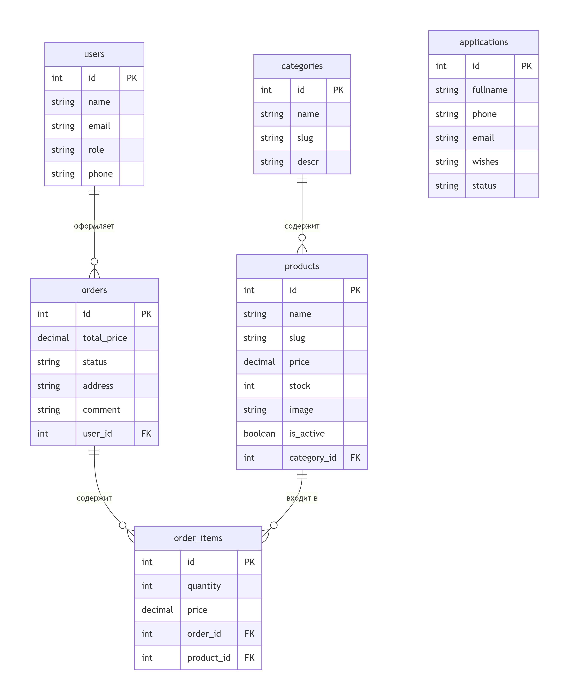
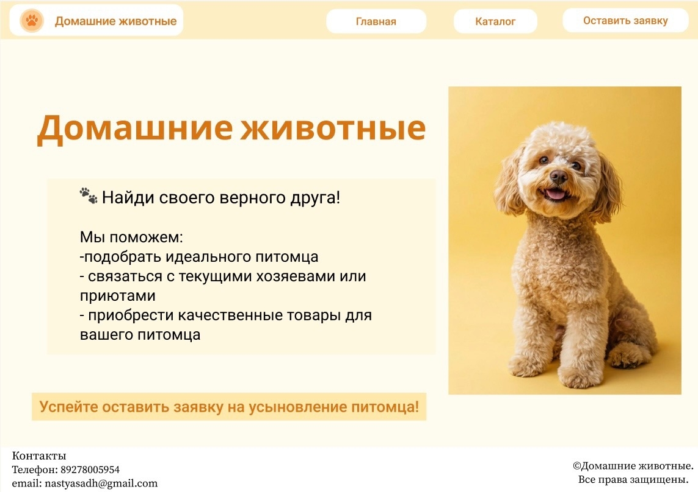
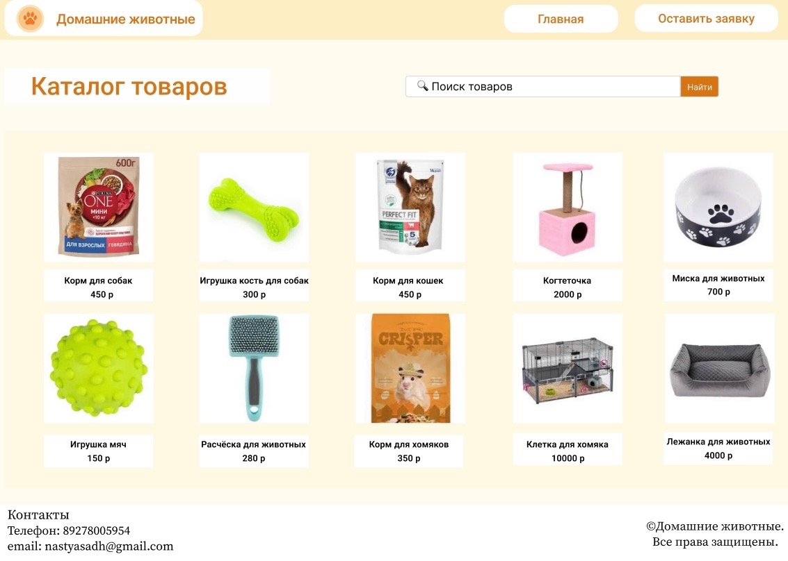
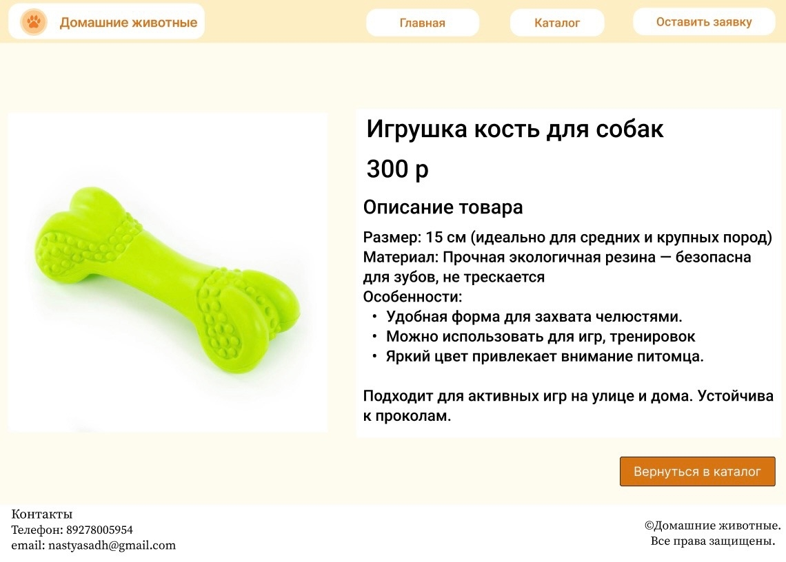
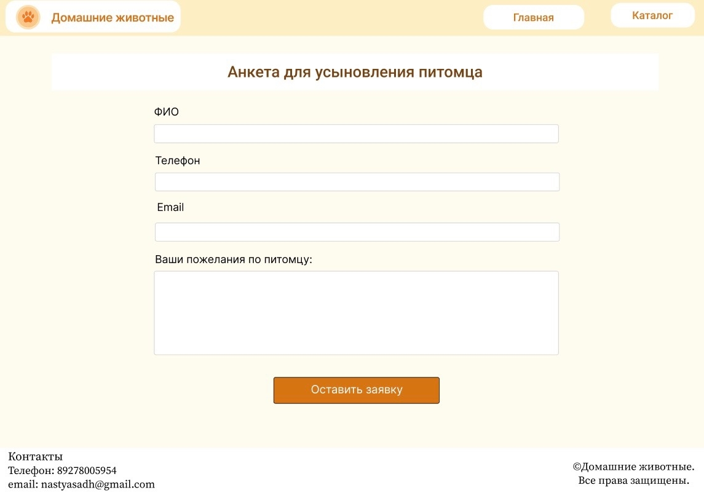

# Онлайн-магазин «Домашние животные»

Учебный интернет-магазин товаров для домашних животных на фреймворке **Laravel 13.31** (PHP 8.5.12, MySQL). Пользователи просматривают каталог, добавляют товары в корзину и оформляют заказы; гости оставляют заявки на питомца; администратор управляет каталогом, заказами и заявками через собственную админ-панель.

---

## 1. Архитектура приложения

### 1.1 Таблицы базы данных

**1. users — пользователи**

| Поле | Тип данных | Описание |
|---|---|---|
| id | BIGINT UNSIGNED (PK, auto_increment) | Идентификатор |
| name | VARCHAR(255) | ФИО пользователя |
| email | VARCHAR(255), unique | Email для авторизации |
| email_verified_at | TIMESTAMP, nullable | Дата подтверждения email |
| password | VARCHAR(255) | Хеш пароля |
| role | ENUM('user', 'admin'), default 'user' | Роль пользователя |
| phone | VARCHAR(255), nullable | Номер телефона |
| remember_token | VARCHAR(100), nullable | Токен «Запомнить меня» |
| created_at, updated_at | TIMESTAMP, nullable | Служебные даты |

**2. categories — категории товаров**

| Поле | Тип данных | Описание |
|---|---|---|
| id | BIGINT UNSIGNED (PK, auto_increment) | Идентификатор |
| name | VARCHAR(255) | Название категории |
| slug | VARCHAR(255), unique | URL-friendly идентификатор |
| description | TEXT, nullable | Описание категории |
| deleted_at | TIMESTAMP, nullable | Мягкое удаление (SoftDeletes) |
| created_at, updated_at | TIMESTAMP, nullable | Служебные даты |

**3. products — товары**

| Поле | Тип данных | Описание |
|---|---|---|
| id | BIGINT UNSIGNED (PK, auto_increment) | Идентификатор |
| category_id | BIGINT UNSIGNED, nullable (FK → categories.id) | Категория товара |
| name | VARCHAR(255) | Название товара |
| slug | VARCHAR(255), unique | URL-friendly идентификатор |
| description | TEXT, nullable | Описание товара |
| price | DECIMAL(10, 2) | Цена товара |
| stock | INT UNSIGNED, default 0 | Остаток на складе |
| image | VARCHAR(255), nullable | Путь к изображению |
| is_active | BOOLEAN, default 1 | Видимость товара в каталоге |
| deleted_at | TIMESTAMP, nullable | Мягкое удаление (SoftDeletes) |
| created_at, updated_at | TIMESTAMP, nullable | Служебные даты |

**4. orders — заказы**

| Поле | Тип данных | Описание |
|---|---|---|
| id | BIGINT UNSIGNED (PK, auto_increment) | Идентификатор заказа |
| user_id | BIGINT UNSIGNED (FK → users.id) | Покупатель |
| total_price | DECIMAL(10, 2) | Итоговая стоимость |
| status | ENUM('pending', 'processing', 'shipped', 'delivered', 'cancelled') | Статус заказа |
| address | TEXT, nullable | Адрес доставки |
| comment | TEXT, nullable | Комментарий к заказу |
| created_at, updated_at | TIMESTAMP, nullable | Служебные даты |

**5. order_items — позиции заказа**

| Поле | Тип данных | Описание |
|---|---|---|
| id | BIGINT UNSIGNED (PK, auto_increment) | Идентификатор |
| order_id | BIGINT UNSIGNED (FK → orders.id) | Заказ |
| product_id | BIGINT UNSIGNED (FK → products.id) | Товар |
| quantity | INT UNSIGNED | Количество |
| price | DECIMAL(10, 2) | Цена на момент покупки |
| created_at, updated_at | TIMESTAMP, nullable | Служебные даты |

**6. applications — заявки (обратная связь / усыновление)**

| Поле | Тип данных | Описание |
|---|---|---|
| id | BIGINT UNSIGNED (PK, auto_increment) | Идентификатор заявки |
| fullname | VARCHAR(255) | ФИО заявителя |
| phone | VARCHAR(255) | Номер телефона |
| email | VARCHAR(255) | Email |
| wishes | TEXT, nullable | Пожелания |
| status | ENUM('new', 'in_progress', 'completed', 'rejected'), default 'new' | Статус заявки |
| created_at, updated_at | TIMESTAMP, nullable | Служебные даты |

Служебные таблицы Laravel: `password_reset_tokens`, `sessions`, `cache`, `cache_locks`, `jobs`, `job_batches`, `failed_jobs`.

### 1.2 Связи между таблицами



| Связь | Тип | Описание |
|---|---|---|
| `categories` → `products` | Один-ко-многим (1:N) | Категория содержит множество товаров |
| `users` → `orders` | Один-ко-многим (1:N) | Пользователь может иметь множество заказов |
| `orders` → `order_items` | Один-ко-многим (1:N) | Заказ содержит множество позиций |
| `products` → `order_items` | Один-ко-многим (1:N) | Товар может входить в множество позиций |
| `applications` | Без связей | Самостоятельная таблица заявок |

Внешние ключи:

- `products.category_id` → `categories.id`, `nullOnDelete()`: при **физическом** удалении категории товары остаются с `category_id = NULL`;
- `orders.user_id` → `users.id`, `cascadeOnDelete()`;
- `order_items.order_id` → `orders.id`, `cascadeOnDelete()`;
- `order_items.product_id` → `products.id`, `cascadeOnDelete()`.

Категории и товары используют **мягкое удаление** (`deleted_at`). Мягкое удаление категории не обнуляет `category_id` у товаров; товары скрываются вместе с ней только на уровне выборки каталога.

### 1.3 Карта экранов

**Публичные страницы**

| URL | Имя маршрута | Контроллер / шаблон |
|---|---|---|
| `/` | `home` | замыкание → `resources/views/home/index.blade.php` |
| `/catalog` | `catalog.index` | `ProductController@index` → `catalog.index` |
| `/products/{product:slug}` | `products.show` | `ProductController@show` → `products.show` |
| `/applications/create` | `applications.create` | `ApplicationController@create` |
| `/login` | `login` | `Auth\LoginController@showLoginForm` |
| `/register` | `register` | `Auth\RegisterController@showRegistrationForm` |
| `/password/reset` | `password.request` | `Auth\ForgotPasswordController@showLinkRequestForm` |
| `/password/email` | `password.email` | `Auth\ForgotPasswordController@sendResetLinkEmail` |
| `/password/reset/{token}` | `password.reset` | `Auth\ResetPasswordController@showResetForm` |
| `/password/confirm` | `password.confirm` | `Auth\ConfirmPasswordController@showConfirmForm` |

**Страницы авторизованного пользователя**

| URL | Имя маршрута | Контроллер / шаблон |
|---|---|---|
| `/cart` | `cart.index` | `CartController@index` → `cart.index` |
| `/checkout` | `checkout.create` | `CheckoutController@create` → `checkout.index` |
| `/profile` | `profile.show` | `ProfileController@show` → `profile.show` |
| `/profile/orders` | `profile.orders` | `ProfileController@orders` → `profile.orders` |
| `/profile/orders/{id}` | `profile.order.show` | `ProfileController@orderShow` → `profile.order-show` |

**Админ-панель** (`/admin`, middleware `auth` + `admin`)

| URL | Имя маршрута | Контроллер / шаблон |
|---|---|---|
| `/admin/dashboard` | `admin.dashboard` | `Admin\DashboardController@index` → `admin.dashboard` |
| `/admin/products` | `admin.products.index` | `Admin\ProductController@index` |
| `/admin/products/create` | `admin.products.create` | `Admin\ProductController@create` |
| `/admin/products/{product}` | `admin.products.show` | `Admin\ProductController@show` |
| `/admin/products/{product}/edit` | `admin.products.edit` | `Admin\ProductController@edit` |
| `/admin/categories` | `admin.categories.index` | `Admin\CategoryController@index` |
| `/admin/categories/create` | `admin.categories.create` | `Admin\CategoryController@create` |
| `/admin/categories/{category}/edit` | `admin.categories.edit` | `Admin\CategoryController@edit` |
| `/admin/orders` | `admin.orders.index` | `Admin\OrderController@index` |
| `/admin/orders/{order}` | `admin.orders.show` | `Admin\OrderController@show` |
| `/admin/applications` | `admin.applications.index` | `Admin\ApplicationController@index` |
| `/admin/applications/{application}` | `admin.applications.show` | `Admin\ApplicationController@show` |

Скриншоты публичной части:



**HOME — Главная страница**



**CATALOG — Каталог товаров**



**PRODUCT — Страница товара**



**APPLICATION — Форма заявки**

### 1.4 Роли и сценарии поведения

| Роль | Описание | Права |
|---|---|---|
| **Гость** | Незарегистрированный посетитель | Просмотр главной, каталога и товаров, поиск, оставление заявки, регистрация и вход |
| **User (покупатель)** | Зарегистрированный пользователь | Всё, что у гостя + корзина, оформление заказа, профиль, история заказов |
| **Admin (администратор)** | Управляет магазином | Всё, что у покупателя + админ-панель: товары, категории, заказы, заявки |

**Сценарий 1. Просмотр каталога (гость)**

`Главная → Каталог → Карточка товара`

1. Пользователь открывает главную страницу.
2. Переходит в каталог, при необходимости использует поиск по названию и фильтр по категории.
3. Открывает карточку товара и просматривает описание, цену, остаток.

**Сценарий 2. Оформление заказа (User)**

`Каталог → Карточка товара → Корзина → Оформление → Подтверждение`

1. Пользователь авторизуется.
2. Добавляет товар в корзину с нужным количеством.
3. Проверяет состав корзины и переходит к оформлению.
4. Указывает адрес доставки и комментарий.
5. Подтверждает заказ: в транзакции создаются `orders` и `order_items`, остаток товара уменьшается.

**Сценарий 3. Подача заявки (гость / User)**

`Главная → Оставить заявку → Отправка`

1. Пользователь заполняет ФИО, телефон, email и пожелания.
2. Заявка сохраняется в `applications` со статусом `new`.
3. Администратор обрабатывает заявку в админ-панели.

**Сценарий 4. Управление магазином (Admin)**

`Вход → Админ-панель → Товары / Категории / Заказы / Заявки`

1. Администратор входит в систему и автоматически попадает на дашборд.
2. Создаёт, редактирует и мягко удаляет товары и категории.
3. Меняет статусы заказов и отменяет заказы.
4. Модерирует заявки: `new → in_progress → completed` или `rejected`.

**Сценарий 5. Восстановление пароля (гость)**

`Вход → Забыли пароль? → Email → Ссылка из письма → Новый пароль`

Реализовано стандартными маршрутами Laravel UI (`password.request`, `password.email`, `password.reset`, `password.update`).

### 1.5 Формы

**Форма 1. Заявка на питомца / обратная связь**

| Поле | Тип | Обязательное | Валидация | Таблица / поле |
|---|---|---|---|---|
| ФИО | text | Да | `required, string, max:255` | `applications.fullname` |
| Телефон | tel | Да | `required, string, max:20` | `applications.phone` |
| Email | email | Да | `required, email, max:255` | `applications.email` |
| Пожелания | textarea | Нет | `nullable, string` | `applications.wishes` |

Метод: `POST /applications`, контроллер: `ApplicationController@store`.

**Форма 2. Регистрация**

| Поле | Тип | Обязательное | Валидация | Таблица / поле |
|---|---|---|---|---|
| ФИО | text | Да | `required, string, max:255` | `users.name` |
| Email | email | Да | `required, email, max:255, unique:users` | `users.email` |
| Телефон | tel | Нет | `nullable, string, max:20` | `users.phone` |
| Пароль | password | Да | `required, string, min:8, confirmed` | `users.password` |
| Подтверждение пароля | password | Да | `required, same:password` | — |

Метод: `POST /register`, контроллер: `Auth\RegisterController@register` (Laravel UI).

**Форма 3. Авторизация**

| Поле | Тип | Обязательное | Валидация | Таблица / поле |
|---|---|---|---|---|
| Email | email | Да | `required, email` | `users.email` |
| Пароль | password | Да | `required, string` | `users.password` |
| Запомнить меня | checkbox | Нет | `boolean` | `remember_token` |

Метод: `POST /login`, контроллер: `Auth\LoginController@login` (Laravel UI).

**Форма 4. Оформление заказа**

| Поле | Тип | Обязательное | Валидация | Таблица / поле |
|---|---|---|---|---|
| Адрес доставки | textarea | Да | `required, string` | `orders.address` |
| Комментарий | textarea | Нет | `nullable, string` | `orders.comment` |

Метод: `POST /checkout`, контроллер: `CheckoutController@store`.
Состав корзины хранится в сессии (`session('cart')`), а не в скрытых полях формы.

**Форма 5. Редактирование профиля**

| Поле | Тип | Обязательное | Валидация | Таблица / поле |
|---|---|---|---|---|
| ФИО | text | Да | `required, string, max:255` | `users.name` |
| Телефон | tel | Нет | `nullable, string, max:20` | `users.phone` |

Метод: `PUT /profile`, контроллер: `ProfileController@update`.

**Форма 6. Админ — создание/редактирование товара**

| Поле | Тип | Обязательное | Валидация | Таблица / поле |
|---|---|---|---|---|
| Название | text | Да | `required, string, max:255` | `products.name` |
| Описание | textarea | Нет | `nullable, string` | `products.description` |
| Цена | number | Да | `required, numeric, min:0` | `products.price` |
| Остаток | number | Да | `required, integer, min:0` | `products.stock` |
| Категория | select | Да | `required, exists:categories,id` | `products.category_id` |
| Изображение | file | Нет | `nullable, image, max:2048` | `products.image` |
| Опубликовать | checkbox | Нет | `boolean` | `products.is_active` |

Slug формируется автоматически из названия и проверяется на уникальность (включая мягко удалённые товары).
Методы: `POST /admin/products`, `PUT /admin/products/{product}`, контроллер: `Admin\ProductController@store` / `@update`.

**Форма 7. Админ — создание/редактирование категории**

| Поле | Тип | Обязательное | Валидация | Таблица / поле |
|---|---|---|---|---|
| Название | text | Да | `required, string, max:255` | `categories.name` |
| Slug | text | Да | `required, string, max:255, unique:categories,slug` | `categories.slug` |
| Описание | textarea | Нет | `nullable, string` | `categories.description` |

Методы: `POST /admin/categories`, `PUT /admin/categories/{category}`, контроллер: `Admin\CategoryController@store` / `@update`.

**Служебные формы**

- изменение количества и удаление товара в корзине — `CartController@update` / `@remove`;
- смена статуса заказа — `PATCH /admin/orders/{order}/status`, `Admin\OrderController@updateStatus`;
- отмена заказа — `POST /admin/orders/{order}/cancel`, `Admin\OrderController@cancel`;
- смена статуса заявки — `PATCH /admin/applications/{application}/status`, `Admin\ApplicationController@updateStatus`.

### 1.6 Обработка запроса (MVC-поток)

```
HTTP-запрос
   │
   ▼
public/index.php → bootstrap/app.php
   │
   ▼
routes/web.php (публичные и пользовательские маршруты)
routes/admin.php (админ-панель, подключается в bootstrap/app.php)
   │
   ▼
Middleware
   ├── web    — сессии, CSRF
   ├── auth   — корзина, checkout, профиль, админка
   └── admin  — проверка role = 'admin' (AdminMiddleware)
   │
   ▼
Controller (App\Http\Controllers\...)
   ├── валидация запроса — средствами контроллера ($request->validate)
   └── Model (App\Models\Shop\...) — Eloquent
   │
   ▼
Blade View (resources/views/...) → HTML-ответ
```

Отдельных FormRequest, Service/Action и Policy-классов в проекте нет: валидация и бизнес-логика находятся в контроллерах, доступ к админке ограничен middleware.

### 1.7 Структура проекта

```
online_shop.local/
├── app/
│   ├── Http/
│   │   ├── Controllers/
│   │   │   ├── BaseController.php      # общий предок контроллеров
│   │   │   ├── Controller.php          # базовый Controller Laravel
│   │   │   ├── ProductController.php   # каталог и карточка товара
│   │   │   ├── CartController.php      # корзина
│   │   │   ├── CheckoutController.php  # оформление заказа
│   │   │   ├── ApplicationController.php
│   │   │   ├── ProfileController.php
│   │   │   ├── Auth/                   # Laravel UI: вход, регистрация, сброс пароля
│   │   │   └── Admin/                  # админ-панель
│   │   │       ├── DashboardController.php
│   │   │       ├── ProductController.php
│   │   │       ├── CategoryController.php
│   │   │       ├── OrderController.php
│   │   │       └── ApplicationController.php
│   │   └── Middleware/
│   │       └── AdminMiddleware.php
│   ├── Models/
│   │   ├── User.php
│   │   └── Shop/                       # модели предметной области
│   │       ├── Category.php
│   │       ├── Product.php
│   │       ├── Order.php
│   │       ├── OrderItem.php
│   │       └── Application.php
│   └── Providers/
├── database/
│   ├── migrations/                     # миграции БД
│   ├── seeders/                        # демонстрационные данные
│   └── factories/                      # UserFactory
├── lang/
│   ├── ru/                             # русские переводы
│   └── ru.json
├── public/
│   ├── css/styles.css                  # основные стили
│   ├── js/script.js
│   ├── images/                         # logo.png, dog.jpg, no-image.svg
│   └── index.php
├── resources/
│   ├── views/
│   │   ├── layouts/                    # app.blade.php, admin.blade.php
│   │   ├── home/                       # главная
│   │   ├── catalog/                    # каталог
│   │   ├── products/                   # карточка товара
│   │   ├── auth/                       # вход, регистрация, сброс пароля
│   │   ├── cart/
│   │   ├── checkout/
│   │   ├── profile/
│   │   ├── applications/
│   │   └── admin/
│   ├── sass/                           # Bootstrap-пресет Laravel UI
│   └── js/
├── routes/
│   ├── web.php
│   ├── admin.php
│   └── console.php
├── tests/
│   ├── Feature/ShopTest.php
│   ├── Feature/ExampleTest.php
│   └── Unit/ExampleTest.php
├── composer.json
├── composer.phar
├── package.json
└── vite.config.js
```

### 1.8 Технологии

| Компонент | Технология |
|---|---|
| Фреймворк | Laravel 13.31 |
| Язык | PHP 8.5.12 |
| БД | MySQL (`online_shop`, utf8mb4) |
| ORM | Eloquent |
| Шаблонизатор | Blade |
| Авторизация | Laravel UI 4.6 (`Auth::routes()`, контроллеры `App\Http\Controllers\Auth`) |
| DocBlock | Laravel IDE Helper 3.8 (установлен в dev-зависимости) |
| Фронтенд | Собственные `public/css/styles.css` и `public/js/script.js`; Bootstrap 5 и Vite добавлены Laravel UI в `package.json` |
| Тесты | PHPUnit 12 |

> **Laravel-admin не установлен.** Пакет `encore/laravel-admin` несовместим с Laravel 13 (требует `doctrine/dbal 2.*`) и заблокирован Composer из-за security advisories. Вместо него реализована собственная админ-панель на Blade с той же функциональностью: CRUD товаров и категорий, обработка заказов, модерация заявок, дашборд.

---

## 2. Функционал администратора

### 2.1 Матрица прав доступа

| Действие | Гость | User | Admin |
|---|---|---|---|
| Просмотр каталога и товаров | ✔ | ✔ | ✔ |
| Поиск и фильтрация товаров | ✔ | ✔ | ✔ |
| Регистрация / авторизация | ✔ | ✔ | ✔ |
| Восстановление пароля | ✔ | ✔ | ✔ |
| Оставить заявку | ✔ | ✔ | ✔ |
| Просмотр и редактирование профиля | ✘ | ✔ | ✔ |
| Корзина | ✘ | ✔ | ✔ |
| Оформление заказа | ✘ | ✔ | ✔ |
| Просмотр своих заказов | ✘ | ✔ | ✔ |
| CRUD товаров | ✘ | ✘ | ✔ |
| CRUD категорий | ✘ | ✘ | ✔ |
| Обработка заказов (смена статуса, отмена) | ✘ | ✘ | ✔ |
| Модерирование заявок | ✘ | ✘ | ✔ |
| Дашборд со статистикой | ✘ | ✘ | ✔ |

**Механизм реализации:**

| Компонент | Описание |
|---|---|
| Поле `role` в `users` | `ENUM('user', 'admin')`, по умолчанию `user` |
| `User::isAdmin()` | `return $this->role === 'admin';` |
| Middleware `AdminMiddleware` | `if (!Auth::check() \|\| !Auth::user()->isAdmin()) abort(403);` |
| Группа маршрутов `/admin` | `middleware(['auth', 'admin'])->prefix('admin')->name('admin.')` |
| Ресурсные маршруты | `Route::resource('products', ...)`, `Route::resource('categories', ...)` |

### 2.2 Добавление данных (Create)

| Ресурс | Форма | Контроллер | Маршрут |
|---|---|---|---|
| Товар | Название, описание, цена, остаток, категория, изображение, публикация | `Admin\ProductController@store` | `POST /admin/products` |
| Категория | Название, slug, описание | `Admin\CategoryController@store` | `POST /admin/categories` |

### 2.3 Просмотр данных (Read)

| Ресурс | Представление | Маршрут | Контроллер |
|---|---|---|---|
| Список товаров | `resources/views/admin/products/index.blade.php` | `GET /admin/products` | `index()` |
| Карточка товара | `resources/views/admin/products/show.blade.php` | `GET /admin/products/{product}` | `show()` |
| Список категорий | `resources/views/admin/categories/index.blade.php` | `GET /admin/categories` | `index()` |
| Список заказов | `resources/views/admin/orders/index.blade.php` | `GET /admin/orders` | `index()` |
| Детали заказа | `resources/views/admin/orders/show.blade.php` | `GET /admin/orders/{order}` | `show()` |
| Список заявок | `resources/views/admin/applications/index.blade.php` | `GET /admin/applications` | `index()` |
| Детали заявки | `resources/views/admin/applications/show.blade.php` | `GET /admin/applications/{application}` | `show()` |

Все списки используют пагинацию (`paginate(15)`) и поиск. Товары и категории выводятся вместе с мягко удалёнными записями (`withTrashed()`); для удалённых товаров доступны просмотр и редактирование.

### 2.4 Удаление данных (Delete)

| Ресурс | Способ | Поведение |
|---|---|---|
| Товар | `SoftDeletes` | Запись получает `deleted_at`, физически не удаляется |
| Категория | `SoftDeletes` | Запись получает `deleted_at`; товары сохраняют `category_id` |
| Заказ | Не удаляется | Меняется статус на `cancelled` |
| Заявка | Не удаляется | Меняется статус на `rejected` |

### 2.5 Модерирование данных

**Заявки (`applications`)**

```
new ──▶ in_progress ──▶ completed
          │
          └──────▶ rejected
```

**Товары**

| Действие | Что происходит |
|---|---|
| Опубликовать | `is_active = 1` — товар виден в каталоге |
| Снять с продажи | `is_active = 0` — товар скрыт из каталога, но остаётся в БД |
| Мягко удалить | `deleted_at` заполняется, товар исчезает из каталога |

### 2.6 Обработка заказа

```
pending ──▶ processing ──▶ shipped ──▶ delivered
   │            │
   │            └─────▶ cancelled
   └──────────────▶ cancelled
```

| Статус | Значение |
|---|---|
| `pending` | Новый заказ, ожидает обработки |
| `processing` | В обработке |
| `shipped` | Отправлен |
| `delivered` | Доставлен |
| `cancelled` | Отменён |

Маршруты:

| Действие | Маршрут | Контроллер |
|---|---|---|
| Список заказов | `GET /admin/orders` | `Admin\OrderController@index` |
| Детали заказа | `GET /admin/orders/{order}` | `Admin\OrderController@show` |
| Смена статуса | `PATCH /admin/orders/{order}/status` | `Admin\OrderController@updateStatus` |
| Отмена заказа | `POST /admin/orders/{order}/cancel` | `Admin\OrderController@cancel` |

### 2.7 Итоговая маршрутизация админ-панели

| Метод | URL | Имя | Назначение |
|---|---|---|---|
| GET | `/admin/dashboard` | `admin.dashboard` | Статистика |
| GET | `/admin/products` | `admin.products.index` | Список товаров |
| GET | `/admin/products/create` | `admin.products.create` | Форма создания |
| POST | `/admin/products` | `admin.products.store` | Создать товар |
| GET | `/admin/products/{product}` | `admin.products.show` | Просмотр товара |
| GET | `/admin/products/{product}/edit` | `admin.products.edit` | Форма редактирования |
| PUT/PATCH | `/admin/products/{product}` | `admin.products.update` | Обновить товар |
| DELETE | `/admin/products/{product}` | `admin.products.destroy` | Мягко удалить товар |
| GET | `/admin/categories` | `admin.categories.index` | Список категорий |
| GET | `/admin/categories/create` | `admin.categories.create` | Форма создания |
| POST | `/admin/categories` | `admin.categories.store` | Создать категорию |
| GET | `/admin/categories/{category}/edit` | `admin.categories.edit` | Форма редактирования |
| PUT/PATCH | `/admin/categories/{category}` | `admin.categories.update` | Обновить категорию |
| DELETE | `/admin/categories/{category}` | `admin.categories.destroy` | Мягко удалить категорию |
| GET | `/admin/orders` | `admin.orders.index` | Список заказов |
| GET | `/admin/orders/{order}` | `admin.orders.show` | Детали заказа |
| PATCH | `/admin/orders/{order}/status` | `admin.orders.status` | Смена статуса |
| POST | `/admin/orders/{order}/cancel` | `admin.orders.cancel` | Отмена заказа |
| GET | `/admin/applications` | `admin.applications.index` | Список заявок |
| GET | `/admin/applications/{application}` | `admin.applications.show` | Детали заявки |
| PATCH | `/admin/applications/{application}/status` | `admin.applications.status` | Смена статуса |

### 2.8 Структура админ-модуля

```
app/
├── Http/
│   ├── Controllers/
│   │   ├── BaseController.php
│   │   └── Admin/
│   │       ├── DashboardController.php
│   │       ├── ProductController.php
│   │       ├── CategoryController.php
│   │       ├── OrderController.php
│   │       └── ApplicationController.php
│   └── Middleware/
│       └── AdminMiddleware.php
└── Models/
    ├── User.php
    └── Shop/
        ├── Product.php
        ├── Category.php
        ├── Order.php
        ├── OrderItem.php
        └── Application.php
```

### 2.9 Тестирование

| Сценарий | Тест |
|---|---|
| Гость видит главную, каталог и товар | `ShopTest::test_guest_can_view_home_catalog_and_product` |
| Неактивный товар скрыт от гостя и виден админу | `ShopTest::test_inactive_product_is_hidden_from_guest_and_visible_to_admin` |
| Регистрация пользователя | `ShopTest::test_user_can_register` |
| Вход пользователя | `ShopTest::test_user_can_login` |
| Админ после входа попадает на дашборд | `ShopTest::test_admin_is_redirected_to_dashboard_after_login` |
| Не-админ получает 403 | `ShopTest::test_non_admin_cannot_open_admin_panel` |
| Уникальность slug товара | `ShopTest::test_admin_can_create_product_with_unique_slug` |
| Обновление и мягкое удаление товара | `ShopTest::test_admin_can_update_and_soft_delete_product` |
| Просмотр мягко удалённого товара | `ShopTest::test_admin_can_view_soft_deleted_product` |
| Оформление заказа и списание остатка | `ShopTest::test_user_can_checkout_and_stock_is_decremented` |
| Оформление заказа с удалённым товаром | `ShopTest::test_checkout_with_deleted_product_returns_error_instead_of_exception` |
| Отправка заявки | `ShopTest::test_user_can_submit_application` |
| Смена статуса заказа | `ShopTest::test_admin_can_update_order_status` |
| Запрет просмотра чужого заказа | `ShopTest::test_user_cannot_view_another_users_order` |
| Модерация заявки | `ShopTest::test_application_can_be_moderated_by_admin` |

---

## 3. Установка и запуск

### 3.1 Требования

- PHP 8.5+ с расширениями `pdo_mysql`, `mbstring`, `openssl`;
- Composer (в проекте есть локальный `composer.phar`);
- MySQL / MariaDB (XAMPP);
- Node.js и npm — только для сборки Bootstrap-пресета Laravel UI (`npm install && npm run dev`); для работы текущих шаблонов не обязательны, так как они используют `public/css/styles.css`.

### 3.2 Разворачивание

```sh
php composer.phar install
copy .env.example .env
php artisan key:generate
php artisan migrate --seed
php artisan storage:link
```

В `.env` указать параметры БД:

```env
DB_CONNECTION=mysql
DB_HOST=127.0.0.1
DB_PORT=3306
DB_DATABASE=online_shop
DB_USERNAME=root
DB_PASSWORD=
```

### 3.3 Запуск

Вариант 1 — встроенный сервер Laravel:

```sh
php artisan serve
```

Вариант 2 — XAMPP: настроить виртуальный хост `online_shop.local` на папку `public` и добавить запись в `hosts`.

### 3.4 Тестовые учётные записи

Создаются `UserSeeder`:

| Роль | Email | Пароль |
|---|---|---|
| Администратор | `admin@petshop.ru` | `admin12345` |
| Пользователь | `user@petshop.ru` | `user12345` |

### 3.5 Тесты

```sh
php vendor/phpunit/phpunit/phpunit --configuration phpunit.xml
```

В текущем окружении команда `php artisan test` может завершаться ошибкой `proc_open(): CreateProcess failed: Отказано в доступе` из-за ограничений Windows-среды, поэтому PHPUnit запускается напрямую.

---

## 4. Соответствие этапам практики

| Этап методички | Реализация |
|---|---|
| 1.1 Таблицы, поля и типы | Раздел 1.1 README, миграции в `database/migrations` |
| 1.2 Связи между таблицами | Раздел 1.2, ER-диаграмма `docs/photo/er-dia.png` |
| 1.3 Карта экранов | Раздел 1.3 |
| 1.4 Роли и сценарии | Раздел 1.4 |
| 1.5 Формы | Раздел 1.5 |
| 2. Окружение (XAMPP, PHP, Composer, Node.js, Git) | PHP 8.5.12, Composer, MySQL/XAMPP; Git-репозиторий ведётся отдельно; Node.js в текущем окружении не установлен |
| 3. База данных через phpMyAdmin | MySQL, БД `online_shop`, кодировка `utf8mb4` |
| 4. Разворачивание через Composer | `composer.json`, `composer.lock`, `composer.phar` |
| 5. Настройка `.env` | `.env.example` |
| 6. Миграции и данные | 9 миграций, сидеры `UserSeeder`, `CategorySeeder`, `ProductSeeder` |
| 7. Контроллер ресурса | `Route::resource` для товаров и категорий в админке; публичный `ProductController` |
| 8. Blade, Laravel UI, авторизация | `layouts/app`, `layouts/admin`, `laravel/ui` 4.6, `Auth::routes()`, контроллеры `Auth\*` |
| 9. Маршрутизация | `routes/web.php`, `routes/admin.php`, 47 маршрутов |
| 10. Laravel-admin | Не установлен из-за несовместимости с Laravel 13 и security advisories; заменён собственной админ-панелью |
| ООП: `BaseController` | `app/Http/Controllers/BaseController.php`, все контроллеры наследуют его |
| Модели в подпапке `app/Models` | `app/Models/Shop/` |
| DocBlock и IDE Helper | `barryvdh/laravel-ide-helper` 3.8, `@property`-аннотации в моделях |

---

## 5. Известные ограничения

1. **Laravel-admin** не установлен: последняя версия пакета требует `doctrine/dbal 2.*` и несовместима с Laravel 13; Composer также блокирует её из-за security advisories. Админ-панель реализована самостоятельно.
2. **Изображения товаров.** В `ProductSeeder` указаны пути `images/product1.png` … `images/product10.png`, но сами файлы в репозиторий не добавлены. Модель `Product` проверяет наличие файла и при его отсутствии шаблоны показывают placeholder `public/images/no-image.svg`.
3. **Node.js/npm** в текущем окружении не установлены, поэтому `npm install && npm run dev` не выполнялись. Шаблоны не используют директиву `@vite` и работают на `public/css/styles.css`.
4. **Git.** Репозиторий проекта ведётся в отдельной папке; в текущей рабочей копии каталог `.git` отсутствует.
5. **`php artisan test`** может быть недоступен в ограниченной Windows-среде; используйте прямой запуск PHPUnit (раздел 3.5).
