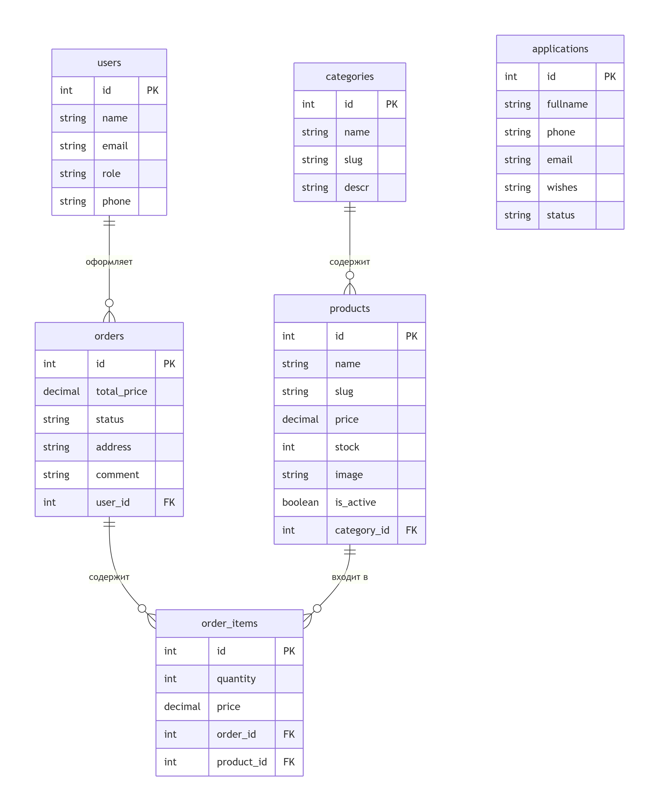
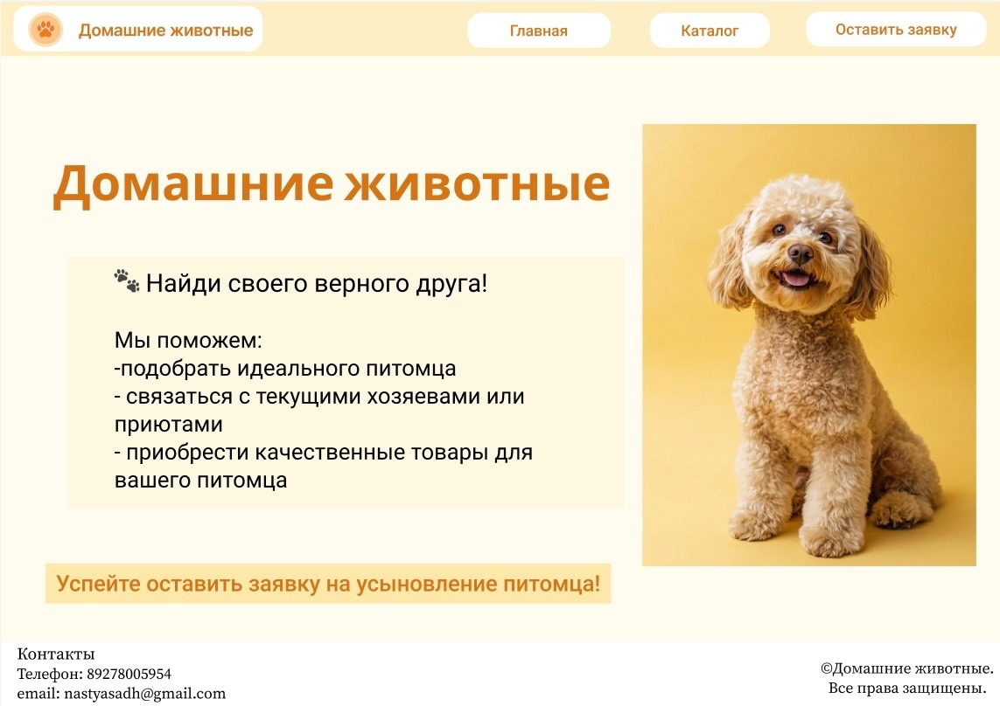
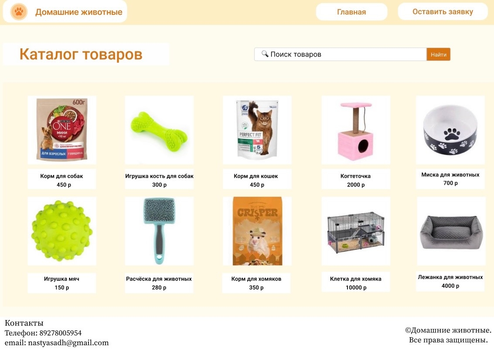
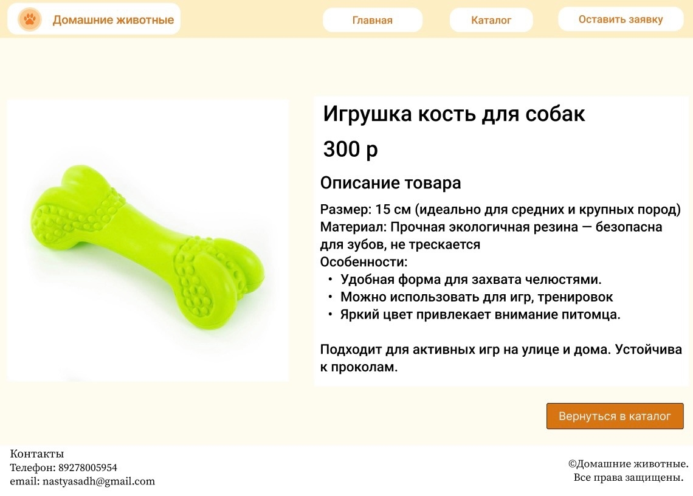
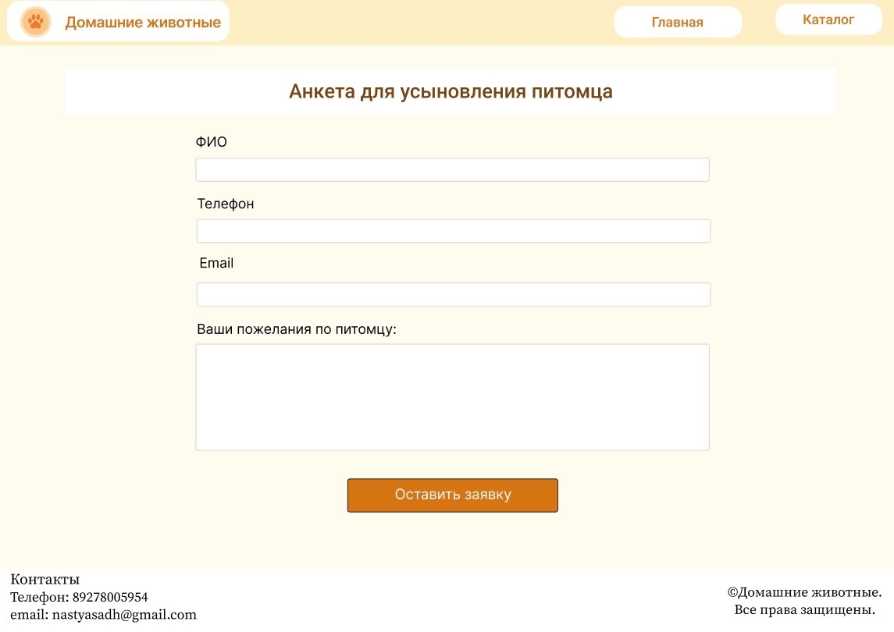

# Онлайн-магазин «Домашние животные»

Интернет-магазин товаров для домашних животных, построенный на фреймворке **Laravel 13** . Приложение позволяет пользователям просматривать каталог товаров, оформлять заказы и оставлять заявки.

## 1. Архитектура приложения

### 1.1 Таблицы базы данных

**1. users — Пользователи**

| Поле | Тип данных | Описание |
|---|---|---|
| id | BIGINT UNSIGNED (PK, auto_increment) | Идентификатор |
| name | VARCHAR(255) | ФИО пользователя |
| email | VARCHAR(255) (unique) | Email для авторизации |
| password | VARCHAR(255) | Хеш пароля |
| role | ENUM('user', 'admin') | Роль пользователя |
| phone | VARCHAR(20) (nullable) | Номер телефона |
| remember_token | VARCHAR(100) (nullable) | Токен «Запомнить меня» |
| created_at | TIMESTAMP (nullable) | Дата регистрации |
| updated_at | TIMESTAMP (nullable) | Время обновления |

**2. categories — Категории товаров**

| Поле | Тип данных | Описание |
|---|---|---|
| id | BIGINT UNSIGNED (PK, auto_increment) | Идентификатор |
| name | VARCHAR(255) | Название категории |
| slug | VARCHAR(255) (unique) | URL-friendly идентификатор |
| description | TEXT (nullable) | Описание категории |
| created_at | TIMESTAMP (nullable) | Дата создания |
| updated_at | TIMESTAMP (nullable) | Время обновления |

**3. products — Товары**

| Поле | Тип данных | Описание |
|---|---|---|
| id | BIGINT UNSIGNED (PK, auto_increment) | Идентификатор |
| name | VARCHAR(255) | Название товара |
| slug | VARCHAR(255) (unique) | URL-friendly идентификатор |
| description | TEXT (nullable) | Описание товара |
| price | DECIMAL(10, 2) | Цена товара |
| stock | INT UNSIGNED | Остаток на складе |
| image | VARCHAR(255) (nullable) | Путь к изображению |
| category_id | BIGINT UNSIGNED (FK) | Ссылка на категорию |
| is_active | BOOLEAN DEFAULT 1 | Видимость товара |
| created_at | TIMESTAMP (nullable) | Дата создания |
| updated_at | TIMESTAMP (nullable) | Время обновления |

**4. orders — Заказы**

| Поле | Тип данных | Описание |
|---|---|---|
| id | BIGINT UNSIGNED (PK, auto_increment) | Идентификатор заказа |
| user_id | BIGINT UNSIGNED (FK) | Идентификатор пользователя |
| total_price | DECIMAL(10, 2) | Итоговая стоимость |
| status | ENUM('pending', 'processing', 'shipped', 'delivered', 'cancelled') | Статус заказа |
| address | TEXT (nullable) | Адрес доставки |
| comment | TEXT (nullable) | Комментарий к заказу |
| created_at | TIMESTAMP (nullable) | Дата создания |
| updated_at | TIMESTAMP (nullable) | Время обновления |

**5. order_items — Позиции заказа**

| Поле | Тип данных | Описание |
|---|---|---|
| id | BIGINT UNSIGNED (PK, auto_increment) | Идентификатор |
| order_id | BIGINT UNSIGNED (FK) | Ссылка на заказ |
| product_id | BIGINT UNSIGNED (FK) | Ссылка на товар |
| quantity | INT UNSIGNED | Количество |
| price | DECIMAL(10, 2) | Цена на момент покупки |
| created_at | TIMESTAMP (nullable) | Дата создания |
| updated_at | TIMESTAMP (nullable) | Время обновления |

**6. applications — Заявки (обратная связь / усыновление)**

| Поле | Тип данных | Описание |
|---|---|---|
| id | BIGINT UNSIGNED (PK, auto_increment) | Идентификатор заявки |
| fullname | VARCHAR(255) | ФИО заявителя |
| phone | VARCHAR(20) | Номер телефона |
| email | VARCHAR(255) | Email |
| wishes | TEXT (nullable) | Пожелания |
| status | ENUM('new', 'in_progress', 'completed', 'rejected') DEFAULT 'new' | Статус заявки |
| created_at | TIMESTAMP (nullable) | Дата создания |
| updated_at | TIMESTAMP (nullable) | Время обновления |

### 1.2 Связи между таблицами

**Описание связей:**

| Связь | Тип | Описание |
|---|---|---|
| `categories` → `products` | Один-ко-многим (1:N) | Категория содержит множество товаров |
| `users` → `orders` | Один-ко-многим (1:N) | Пользователь может иметь множество заказов |
| `orders` → `order_items` | Один-ко-многим (1:N) | Заказ содержит множество позиций |
| `products` → `order_items` | Один-ко-многим (1:N) | Товар может входить в множество позиций |
| `applications` | Нет связей | Самостоятельная таблица заявок |

### 1.3 Карта экранов (страницы приложения)

**HOME — Главная страница**

**CATALOG — Каталог товаров**

**PRODUCT — Страница товара**

**APPLICATION — Форма заявки**

### 1.4 Сценарии поведения пользователей и роли

#### Роли пользователей

| Роль | Описание | Права |
|---|---|---|
| **Гость** | Незарегистрированный посетитель | Просмотр каталога, просмотр товаров, поиск, оставление заявки |
| **User (Покупатель)** | Зарегистрированный пользователь | Всё, что у гостя + оформление заказов, личный кабинет, корзина, история заказов |
| **Admin (Администратор)** | Управляет магазином | Всё, что у покупателя + управление товарами, категориями, заказами, заявками |

#### Сценарии поведения

**Сценарий 1: Просмотр каталога (Гость)**

Посетитель → Главная → Каталог → Карточка товара

1. Пользователь переходит на главную страницу
2. Переходит в каталог товаров
3. Ищет товар через поиск или фильтры
4. Переходит на страницу конкретного товара
5. Просматривает описание, характеристики и цену

**Сценарий 2: Оформление заказа (User)**

User → Каталог → Карточка товара → Корзина → Оформление → Подтверждение

1. Пользователь авторизуется
2. Выбирает товар в каталоге
3. Добавляет товар в корзину
4. Переходит в корзину и подтверждает состав заказа
5. Заполняет адрес доставки и комментарий
6. Подтверждает заказ — создаётся запись в `orders` и `order_items`

**Сценарий 3: Подача заявки (Гость / User)**

Посетитель → Главная/Отдельная страница → Форма заявки → Отправка

1. Пользователь заполняет форму (ФИО, телефон, email, пожелания)
2. Отправляет форму — запись создаётся в таблице `applications`
3. Администратор получает уведомление и обрабатывает заявку

**Сценарий 4: Управление магазином (Admin)**

Admin → Админ-панель → Управление товарами/категориями/заказами/заявками

1. Администратор входит в админ-панель
2. Управляет каталогом (CRUD для товаров и категорий)
3. Отслеживает статусы заказов и обновляет их
4. Обрабатывает заявки от пользователей

### 1.5 Формы

#### Форма 1: Заявка на питомца / Обратная связь

| Поле | Тип | Обязательное | Валидация | Таблица | Поле БД |
|---|---|---|---|---|---|
| ФИО | text | Да | required, string, max:255 | applications | fullname |
| Телефон | tel | Да | required, phone | applications | phone |
| Email | email | Да | required, email, max:255 | applications | email |
| Пожелания | textarea | Нет | string, nullable | applications | wishes |

Метод: POST
Маршрут: /applications
Контроллер: ApplicationController@store

#### Форма 2: Регистрация

| Поле | Тип | Обязательное | Валидация | Таблица | Поле БД |
|---|---|---|---|---|---|
| ФИО | text | Да | required, string, max:255 | users | name |
| Email | email | Да | required, email, unique:users | users | email |
| Пароль | password | Да | required, string, min:8, confirmed | users | password |
| Подтверждение пароля | password | Да | required, same:password | — | — |

Метод: POST
Маршрут: /register
Контроллер: Auth\RegisteredUserController@store

#### Форма 3: Авторизация (Вход)

| Поле | Тип | Обязательное | Валидация | Таблица | Поле БД |
|---|---|---|---|---|---|
| Email | email | Да | required, email | users | email |
| Пароль | password | Да | required, string | users | password |

Метод: POST
Маршрут: /login
Контроллер: Auth\AuthenticatedSessionController@store

#### Форма 4: Оформление заказа

| Поле | Тип | Обязательное | Валидация | Таблица | Поле БД |
|---|---|---|---|---|---|
| Адрес доставки | textarea | Да | required, string | orders | address |
| Комментарий | textarea | Нет | string, nullable | orders | comment |

> Корзина формируется из сессии пользователя (список товаров с количеством).
> Данные корзины не хранятся в форме, а передаются скрытыми полями или из сессии.

Метод: POST
Маршрут: /checkout
Контроллер: CheckoutController@store

#### Форма 5: Редактирование профиля

| Поле | Тип | Обязательное | Валидация | Таблица | Поле БД |
|---|---|---|---|---|---|
| ФИО | text | Да | required, string, max:255 | users | name |
| Телефон | tel | Нет | string, nullable | users | phone |

Метод: PUT/PATCH
Маршрут: /profile
Контроллер: ProfileController@update

#### Форма 6: Админ — Создание/Редактирование товара

| Поле | Тип | Обязательное | Валидация | Таблица | Поле БД |
|---|---|---|---|---|---|
| Название | text | Да | required, string, max:255 | products | name |
| Описание | textarea | Нет | string, nullable | products | description |
| Цена | number | Да | required, numeric, min:0 | products | price |
| Остаток | number | Да | required, integer, min:0 | products | stock |
| Категория | select | Да | required, exists:categories,id | products | category_id |
| Изображение | file | Нет | image, max:2048 | products | image |

Метод: POST (создание) / PUT (редактирование)
Маршрут: /admin/products
Контроллер: Admin\ProductController@store / update

### 1.6 Обработка запроса (MVC-поток)

HTTP-запрос
   │
   ▼
public/index.php  →  bootstrap/app.php
   │
   ▼
routes/web.php  (веб-маршруты)   /   routes/admin.php (при выносе админ-раздела)
   │
   ▼
Middleware
   ├── web        — сессии, CSRF
   ├── auth       — требует авторизации (личный кабинет, корзина, checkout)
   └── admin      — требует роль role = 'admin' (админ-панель)
   │
   ▼
Controller  (App\Http\Controllers\...)
   │
   ├── FormRequest — валидация входных данных (StoreProductRequest, ApplicationRequest ...)
   ├── Model       — Eloquent (Product, Category, Order, OrderItem, Application, User)
   └── Service/Action — бизнес-логика (оформление заказа, пересчёт остатков)
   │
   ▼
Blade View (resources/views/...)  →  HTML-ответ

### 1.7 Структура проекта

online_shop/
├── app/
│   ├── Http/
│   │   ├── Controllers/
│   │   │   ├── Auth/               # Контроллеры авторизации
│   │   │   ├── ProductController   # Каталог и товар
│   │   │   ├── CartController      # Корзина
│   │   │   ├── CheckoutController  # Оформление заказа
│   │   │   ├── ApplicationController # Заявки
│   │   │   ├── ProfileController   # Профиль
│   │   │   └── Admin/              # Админ-панель
│   │   │       ├── ProductController
│   │   │       ├── CategoryController
│   │   │       ├── OrderController
│   │   │       └── ApplicationController
│   │   └── Middleware/
│   │       └── AdminMiddleware     # Проверка роли admin
│   ├── Models/
│   │   ├── User                    # Пользователь
│   │   ├── Category                # Категория товара
│   │   ├── Product                 # Товар
│   │   ├── Order                   # Заказ
│   │   └── OrderItem               # Позиция заказа
│   └── Providers/
├── database/
│   ├── migrations/                 # Миграции БД
│   ├── seeders/                    # Заполнение данных
│   └── factories/                  # Фабрики для тестов
├── resources/
│   ├── views/
│   │   ├── layouts/                # Макеты (app.blade.php)
│   │   ├── home/                   # Главная
│   │   ├── catalog/                # Каталог
│   │   ├── products/               # Страница товара
│   │   ├── auth/                   # Вход / Регистрация
│   │   ├── cart/                   # Корзина
│   │   ├── checkout/               # Оформление
│   │   ├── profile/                # Профиль
│   │   ├── applications/           # Заявки
│   │   └── admin/                  # Админ-панель
│   └── css/                        # Стили
├── routes/
│   └── web.php                     # Маршруты
├── public/                         # Публичные файлы
└── config/                         # Конфигурация

### 1.8 Технологии

| Компонент | Технология |
|---|---|
| Фреймворк | Laravel 13 |
| Язык | PHP 8.3 |
| БД | PostgreSQL |
| ORM | Eloquent |
| Шаблонизатор | Blade |
| Фронтенд | Tailwind CSS (Vite) |
| Аутентификация | Laravel Breeze (встроенные guards) |

## 2. Функционал администратора 

### 2.1 Матрица прав доступа (RBAC)

| Действие | Гость | User | Admin |
|---|---|---|---|
| Просмотр каталога, товаров | ✔ | ✔ | ✔ |
| Поиск и фильтрация товаров | ✔ | ✔ | ✔ |
| Регистрация / Авторизация | ✔ | ✔ | ✔ |
| Просмотр своего профиля | ✘ | ✔ | ✔ |
| Редактирование профиля | ✘ | ✔ | ✔ |
| Добавление в корзину | ✘ | ✔ | ✔ |
| Оформление заказа | ✘ | ✔ | ✔ |
| Просмотр своих заказов | ✘ | ✔ | ✔ |
| Оставить заявку | ✔ | ✔ | ✔ |
| **CRUD товаров** | ✘ | ✘ | ✔ |
| **CRUD категорий** | ✘ | ✘ | ✔ |
| **Обработка заказов** (смена статуса) | ✘ | ✘ | ✔ |
| **Модерирование заявок** | ✘ | ✘ | ✔ |
| Просмотр статистики (дашборд) | ✘ | ✘ | ✔ |

**Механизм реализации:**

| Компонент | Описание |
|---|---|
| Поле `role` в `users` | `ENUM('user', 'admin')` |
| Middleware `AdminMiddleware` | `if (!auth()->user()->isAdmin()) abort(403);` |
| Policy `ProductPolicy` | `update`, `delete`, `create` — только для admin |
| Route-group `/admin` | Все маршруты админ-панели защищены middleware `admin` |

### 2.2 Добавление данных (Create)

Администратор может добавлять:

| Ресурс | Форма | Контроллер | Маршрут |
|---|---|---|---|
| **Товар** | Название, описание, цена, остаток, категория, изображение | `Admin\ProductController@store` | `POST /admin/products` |
| **Категория** | Название, slug, описание | `Admin\CategoryController@store` | `POST /admin/categories` |

### 2.3 Просмотр данных (Read)

| Ресурс | Представление | Маршрут | Контроллер |
|---|---|---|---|
| **Список товаров** | `resources/views/admin/products/index.blade.php` | `GET /admin/products` | `index()` |
| **Карточка товара** | `resources/views/admin/products/show.blade.php` | `GET /admin/products/{product}` | `show()` |
| **Список категорий** | `resources/views/admin/categories/index.blade.php` | `GET /admin/categories` | `index()` |
| **Список заказов** | `resources/views/admin/orders/index.blade.php` | `GET /admin/orders` | `index()` |
| **Детали заказа** | `resources/views/admin/orders/show.blade.php` | `GET /admin/orders/{order}` | `show()` |
| **Список заявок** | `resources/views/admin/applications/index.blade.php` | `GET /admin/applications` | `index()` |
| **Детали заявки** | `resources/views/admin/applications/show.blade.php` | `GET /admin/applications/{application}` | `show()` |

Все списки реализованы с **пагинацией** (`$query->paginate(15)`) и поддержкой **поиска** по названию / email / статусу.

### 2.4 Удаление данных (Delete)

| Ресурс | Способ удаления | Поведение |
|---|---|---|
| **Товар** | `softDelete()` — Laravel soft deletes | Товар не удаляется физически, помечается `deleted_at` |
| **Категория** | `softDelete()` | При удалении категории товары остаются, `category_id` становится `NULL` |
| **Заказ** | Не удаляется (только `cancelled`) | Заказ помечается статусом `cancelled`, данные сохраняются для аудита |
| **Заявка** | Не удаляется | Заявка помечается статусом `rejected` |

### 2.5 Модерирование данных

#### 2.5.1 Модерирование заявок (applications)

| Действие | Что происходит | Статус |
|---|---|---|
| Новый запрос от пользователя | Запись в `applications` со статусом `new` | `new` |
| Принять заявку | Админ меняет статус | `in_progress` |
| Завершить заявку | Заявка выполнена | `completed` |
| Отклонить заявку | Заявка отклонена | `rejected` |

new ──▶ in_progress ──▶ completed
         │
         └──────▶ rejected

#### 2.5.2 Модерирование товаров

| Действие | Что происходит |
|---|---|
| Опубликовать товар | `is_active = 1` — товар появляется в каталоге |
| Снять с продажи | `is_active = 0` — товар скрыт из каталога, но остаётся в БД |

#### 2.5.3 Модерирование отзывов (расширение)

В перспективе может быть добавлена таблица `reviews` с полем `is_approved`, через которое администратор одобряет или отклоняет отзывы пользователей.

### 2.6 Обработка заказа

#### 2.6.1 Жизненный цикл статусов заказа

pending ──▶ processing ──▶ shipped ──▶ delivered
   │            │
   │            └─────▶ cancelled
   │
   └──────────────▶ cancelled

| Статус | Значение | Действие администратора |
|---|---|---|
| `pending` | Новый, ожидает обработки | Проверка наличия, подтверждение |
| `processing` | В обработке | Сборка заказа |
| `shipped` | Отправлен | Уведомление пользователя |
| `delivered` | Доставлен | Заказ закрыт |
| `cancelled` | Отменён | Отмена (пользователем или админом) |

#### 2.6.2 Маршруты обработки заказа

| Действие | Маршрут | Контроллер |
|---|---|---|
| Список заказов | `GET /admin/orders` | `Admin\OrderController@index` |
| Детали заказа | `GET /admin/orders/{order}` | `Admin\OrderController@show` |
| Смена статуса | `PATCH /admin/orders/{order}/status` | `Admin\OrderController@updateStatus` |
| Отмена заказа | `POST /admin/orders/{order}/cancel` | `Admin\OrderController@cancel` |

### 2.7 Итоговая маршрутизация админ-панели

| Префикс | Метод | Контроллер | Назначение |
|---|---|---|---|
| `/admin/dashboard` | `GET` | `Admin\DashboardController@index` | Статистика |
| `/admin/products` | `GET` | `Admin\ProductController@index` | Список товаров |
| `/admin/products` | `POST` | `Admin\ProductController@store` | Создать товар |
| `/admin/products/{product}` | `GET` | `Admin\ProductController@show` | Просмотр товара |
| `/admin/products/{product}` | `PUT` | `Admin\ProductController@update` | Редактировать |
| `/admin/products/{product}` | `DELETE` | `Admin\ProductController@destroy` | Удалить |
| `/admin/categories` | `GET` | `Admin\CategoryController@index` | Список категорий |
| `/admin/categories` | `POST` | `Admin\CategoryController@store` | Создать категорию |
| `/admin/categories/{cat}` | `PUT` | `Admin\CategoryController@update` | Редактировать |
| `/admin/categories/{cat}` | `DELETE` | `Admin\CategoryController@destroy` | Удалить |
| `/admin/orders` | `GET` | `Admin\OrderController@index` | Список заказов |
| `/admin/orders/{order}` | `GET` | `Admin\OrderController@show` | Детали заказа |
| `/admin/orders/{order}/status` | `PATCH` | `Admin\OrderController@updateStatus` | Смена статуса |
| `/admin/applications` | `GET` | `Admin\ApplicationController@index` | Список заявок |
| `/admin/applications/{app}` | `GET` | `Admin\ApplicationController@show` | Детали заявки |
| `/admin/applications/{app}/status` | `PATCH` | `Admin\ApplicationController@updateStatus` | Смена статуса |

### 2.8 Структура админ-модуля

app/
├── Http/
│   ├── Controllers/
│   │   └── Admin/
│   │       ├── DashboardController.php
│   │       ├── ProductController.php
│   │       ├── CategoryController.php
│   │       ├── OrderController.php
│   │       └── ApplicationController.php
│   └── Middleware/
│       └── AdminMiddleware.php
├── Models/
│   ├── Product.php        (SoftDeletes)
│   ├── Category.php       (SoftDeletes)
│   ├── Order.php
│   └── Application.php
├── Policies/
│   ├── ProductPolicy.php
│   └── CategoryPolicy.php
└── Services/
    ├── OrderService.php   (пересчёт итога, списание остатков)
    └── ApplicationService.php (смена статуса, уведомления)

### 2.9 Тестирование админ-функционала

| Сценарий | Тест |
|---|---|
| Админ может создать товар | `ProductTest::test_admin_can_create_product` |
| Админ может отредактировать товар | `ProductTest::test_admin_can_update_product` |
| Админ может удалить товар (soft delete) | `ProductTest::test_admin_can_delete_product` |
| Админ может сменить статус заказа | `OrderTest::test_admin_can_update_order_status` |
| Админ может модерировать заявку | `ApplicationTest::test_admin_can_approve_application` |
| Не-админ получает 403 | `AccessTest::test_non_admin_gets_forbidden` |
